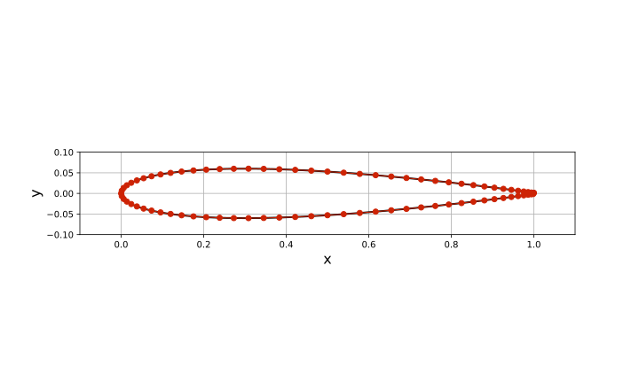
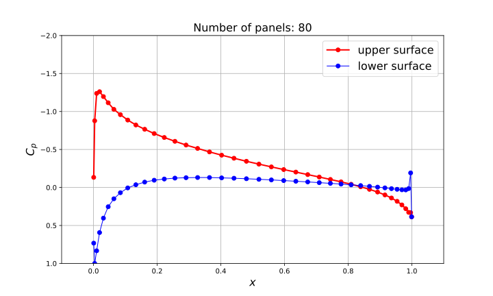
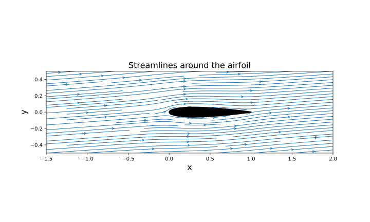

# PyFoilOptimize

[](https://opensource.org/licenses/MIT)
[](https://www.python.org/downloads/release/python-390/)

PyFoilOptimize is a Python-based tool for optimizing airfoil shapes to maximize their lift-to-drag ratio. It uses a panel method for aerodynamic simulation and a numerical optimization algorithm to find the optimal airfoil geometry.

## Getting Started

### Prerequisites

*   Python 3.9 or higher
*   The following Python libraries:
    *   `numpy`
    *   `scipy`
    *   `matplotlib`
    *   `numba`

### Installation

1.  Clone the repository:
    ```bash
    git clone https://github.com/your-username/PyFoilOptimize.git
    ```
2.  Install the required libraries:
    ```bash
    pip install numpy scipy matplotlib numba
    ```

## Usage

To run the simulation and optimization, simply execute the `main.py` script:

```bash
python3 main.py
```

The script will run the simulation on the initial airfoil geometry and generate the following output files in the `assets` directory:

*   `airfoil_shape.svg`: A plot of the airfoil shape.
*   `pressure_coefficient.svg`: A plot of the pressure coefficient distribution on the airfoil surface.
*   `streamlines.svg`: A plot of the streamlines around the airfoil.

## Output

Here are some sample plots generated by the simulation:

### Airfoil Shape



### Pressure Coefficient



### Streamlines


